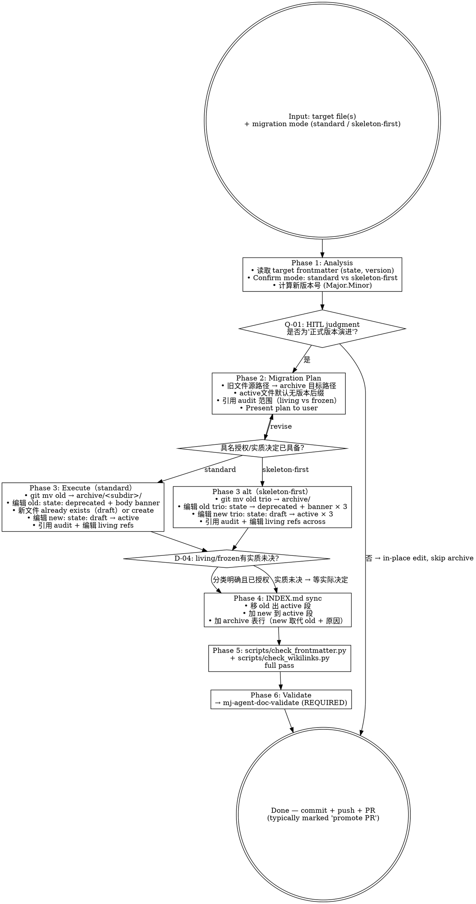

# mj-agent Doc Migrate（archive workflow）

## 本技能的执行约定

执行前读取 [共用执行边界](../../references/execution-boundaries.md)。先核接受基线、任务授权及实际workspace/ref/SHA；基线内普通实施自主，实质安全/业务/权限/breaking/AC/gate变化先Owner决定。授权未撤销且目标/对象/环境/权限/风险未实质变化时复用，普通内容迭代仍核版本但不逐内容重批。技术拒绝保留原错并返回 `BLOCKED_EXECUTION_ROUTE`，不绕过。独立调用返回本范围结果；完整闭环已获授权时按检查点继续；委派返回协调者。


## 触发与职责详述

This skill executes the Major.Minor version archive workflow for mj-agent canonical docs (per ADR-011 §5.6.2 + ADR-014 §决策点 3 skeleton-first 延迟 promote 变体) — moves the old version to the exact canonical archive home chosen by policies/archive.md, flips state to deprecated, adds archive banner, audits corpus-wide wikilinks for living/frozen judgment, updates INDEX.md archive section. Make sure to use this skill whenever the user says "归档文档", "archive doc", "version 升级", "v1.0 → v1.1", "v2.0 → v2.1", "promote PR", "skeleton-first 完成", "迁移到 archive", "doc migrate", "archive workflow" in the mj-agent context. Used by HITL gate at PR review时机；rare operation (~per major version evolution). Do not use for: writing brand new doc (use mj-agent-doc-author), per-file validation (use mj-agent-doc-validate), or in-place daily edits (typo / formatting / minor revision — those stay in-place per ADR-011 HITL A3 mode).


## Overview

执行 mj-agent canonical docs 的 Major.Minor 版本归档流程。**Rare operation** — 仅在正式版本演进（HITL judgment at PR review）触发；日常 typo/measurement 修正 stay in-place。

**两种归档场景**：

1. **正式版本演进**（per ADR-011 §5.6.2 标准模式）：
   - v1.0 → v1.1 / v2.0 → v2.1 等正式版本 bump
   - HITL judgment 决定为"正式演进"时触发
   - 旧文件 git mv → archive；frontmatter state: active → deprecated；body banner；引用 audit

2. **Skeleton-first 延迟 promote**（per ADR-014 §决策点 3 + Meta v2.1 §5.8 mj-agent 专属变体）：
   - 新版本以 state: draft 入 docs/rule/，与旧 active 共存
   - 多 PR 期后（HITL_Prompt §5 矩阵不再指占位时）一次性 promote
   - PR-B3c-promote 是首例（v2.0 trio → archive；v2.1 trio + HITL_Prompt + ADR-014/015/016 → active）

**Reference**:
- `repo:decisions/ADR-011_Doc_Versioning_And_Archive_Convention.md` §5.6.2 标准 archive workflow
- `repo:decisions/ADR-014_Tri_Track_Documentation_Governance.md` §决策点 3 skeleton-first 变体
- `repo:policies/archive.md` §1.1（归档触发判定）+ §2（状态/生命周期）+ §4（STANDARD 整体归档 ceremony；含 skeleton-first 延迟 promote）

> mj-agent 已有 **3 次** archive workflow 先例：
> - v1.0 → v1.1（initial, ADR-011 自身落地，2026-04）
> - v1.1 → v2.0 trio（dual-track 升级，2026-04 ADR-012）
> - v2.0 trio → v2.1 trio + HITL_Prompt（tri-track promote，2026-05 PR-B3c-promote ADR-014）

## When to Use

**MUST run when**：
- 正式版本演进（user / reviewer judgment at PR review HITL）
- skeleton-first delayed promote（多 PR draft 期结束）
- 新增类型变体（ADR/SPEC/STANDARD/EVAL/CONTRACT/ASSESSMENT 含 version 字段）的 minor/major bump

**MAY skip when**：
- 日常 typo / formatting / 小修订（per ADR-011 in-place edit；不触 archive）
- 仅 frontmatter 元数据微调（如 owner / tags）
- working `plans/<topic>/`（含历史根布局）不参与物理归档/GC；状态按 lifecycle 和自身交付条件，主 Plan completed 另需 Owner准确版本接受

**MUST NOT use for**：
- 写新文档 → `mj-agent-doc-author`
- 物理删 legacy → 不允许；archive 仅移动不删
- v4.5 → v5.x 之类跨主版本迁移 → mj-agent 无此场景（始于 v1.0）

## 先按对象分流

读取 [创作与引用说明](../../references/working-docs-and-intent.md)。working 补号/纠错/明确更换主关联是受控路径同步，不是归档：交 doc-sync 修活动引用和路由，核源/目标、Git状态、冲突、完整性，保 task_id/历史基线/INTENT ID，不留第二主 Plan。历史批量迁移仅按已授权具名清单。

INTENT 退役保持原路径与 ID、旧决定、原因/后继，state 只用 deprecated；标题/修订/跨年/重新接受不换 ID。Plan/Issue 完成不触发 INTENT 迁移或状态变化。它不进入下述普通版本归档 ceremony。

其他 canonical 文档继续依 policies/archive 的实际归档模式。活动引用修当前目标；固定提交/完整快照/旧决定按原内容保持可恢复。接受绑定准确内容位置；实质内容变化保留旧决定及影响，旧接受不自动覆盖新内容，纯路径调整不重置业务接受。

## Workflow



## Phase 1: Analysis

```bash
# 读 target frontmatter
head -25 docs/rule/[STANDARD]_*.md
# 期望：state / version / track 字段
```

判断 mode：
- standard（per ADR-011 §5.6.2）：单文件 / 单类 minor.major bump；旧版直接 archive，新版同 PR 落地
- skeleton-first 延迟 promote（per Meta v2.1 §5.8）：新版本已以 state: draft 共存多 PR；本 PR 一次性 promote

计算新版本号（Major.Minor）：
- minor bump（v1.0 → v1.1）：兼容性变更（如 §0/§3.9/§7.3 加注、scope 明确）
- major bump（v1.x → v2.0）：架构变更（如新增 track 字段、双轨升三轨）
- patch（v1.0.1）：mj-agent 不用三段；只用 Major.Minor

## Phase 2: Migration Plan

per output doc：

| 维度 | 内容 |
|---|---|
| 旧路径 | 实际被替代正本准确位置（active默认无版本后缀） |
| 归档路径 | 按 policies/archive 确定的精确 archive unit/文件名及 manifest；不机械套历史 docs/archive |
| 新文件名 | active 默认 `[TYPE]_<topic>.md`，version 在 frontmatter；仅政策明确并存版本例外用后缀 |
| 引用 audit 范围 | 整仓 grep `[[old_filename` + `[STANDARD]_X_v<old>` |
| Living vs Frozen 引用判定 | living: 描述 mj-agent 当前状态 → 升 v<new>；frozen: 描述事故时 / 历史规则 → pin v<old> |

先形成具体可审阅的路径/引用/恢复方案；已有具名迁移授权覆盖的普通步骤自主执行，新的实质决定或删除另交 Owner，不按每个引用重复询问。

## Phase 3: Execute（standard mode）

```bash
# Step 1: git mv old → archive
git mv <confirmed-old-path> <confirmed-archive-path>

# Step 2: 编辑 archived old
#   frontmatter: state: active → deprecated
#   body 顶部加 archive banner（指向新 v<new> + 原因）
#   wikilinks 路径加 ../（多一层目录深度）

# Step 3: 编辑 new v<new>
#   frontmatter: state: draft → active（如 skeleton-first 模式）/ 直接 state: active 落地（如 standard）
#   supersedes: 加 archive 路径
#   body 顶部加 promote banner（指向 archive + 历史 banner 保留）

# Step 4: 引用 audit
#   rg 旧准确路径与相对写法，覆盖docs/plans/policies/sdd/.agents/src/入口及路由；逐项判living/frozen
#   per match：判 living vs frozen
#   - living → 编辑 升 v<new>
#   - frozen → 加 archive 路径前缀 ../archive/rule/

# Step 5: scripts/check_wikilinks.py 验证
uv run python scripts/check_wikilinks.py
```

### Archive banner 模板

```markdown
# <Title>（archived）

> **归档状态（<PR-id> promote 完成后）**：本文档已 `state: deprecated`，被 `<subdir>/[TYPE]_X_v<new>`（示例模板，不是现存资源） 取代。归档原因：<v<new> 主要变更>；详见 `adr/[ADR]_NNN_Decision`（示例模板）。
>
> **历史状态（<原 banner 保留作 cite-by-vintage>）**：<原 banner 内容>
```

按当前 policies/archive 完成适用 manifest、TOMBSTONE、archive INDEX 与必要归档门禁；先核明确源目标/内容/Git状态和重解析点。归档 unit 的可见性与引用边界保持，旧目录示例只作历史来源，不据此改写冻结资料。

## Phase 3 alt: Execute（skeleton-first delayed promote）

参 PR-B3c-promote #67 实例：

- 一次性 git mv 多文件（如 v2.0 trio 3 文件 + HITL_Prompt 已存在不动 + ADR-014/015/016 已存在不动）
- 一次性 编辑：
  - 3 旧文件 state: active → deprecated + banner
  - 3 新文件 state: draft → active + supersedes 加 archive 路径 + banner 替换
  - HITL_Prompt + ADR-015 + ADR-016 reclassify track（per ADR-014 §决策点 4 边界表）
  - scripts/check_frontmatter.py 同期更新（如新 track 值如 engineering-workflow 加入 TRACK_VALUES）
- 一次性引用 audit + 编辑 + INDEX/AGENTS sweep

## D-04: Living / Frozen 引用判定

per ADR-011 §5.6.4 逐项判 living/frozen，引用数量本身不触发重批。模糊且影响原意/基线的真未决项交 Owner；其余在具名范围内修复并报告：

```
检测到 N 处 wikilinks 引用 v<old>。
分类：
- living: <list> → 自动升 v<new>
- frozen: <list> → 保 v<old>（加 archive 路径）
- 模糊: <list> → 用户决定
已确定分类据授权执行；模糊项保持待答并列恢复条件。
```

## Phase 4: INDEX.md sync

按 mj-agent INDEX.md 现有结构：

1. **规则段**：移 old 出，加 new（标 active）
2. **架构决策段** / **评估段** / etc.：同上原则
3. **归档段**：按实际 archive manifest 重建索引，列真实旧/新路径与原因；active新文件默认无版本后缀

## Phase 5: 验证

```bash
uv run python scripts/check_wikilinks.py     # 所有 wikilink resolve
uv run python scripts/check_frontmatter.py   # 本次真实集合/schema结果，不缓存文档计数
```

## Phase 6: Validate

**REQUIRED SUB-SKILL**：`mj-agent-doc-validate` — 全仓 audit。

## What This Skill DOES NOT DO

- ❌ 不删 legacy 文件（archive only； physical delete 是 ADR-011 § Negative consequences 之一拒绝）
- ❌ 不在日常 typo/measurement 触发（per ADR-011 in-place edit principle；HITL judgment 决定是否触本 skill）
- ❌ 不替代 `mj-agent-doc-author`（写新文档；本 skill 仅迁移已有文档）
- ❌ 不替代 `mj-agent-doc-validate`（per-file；本 skill 是 archive 流程编排）
- ❌ 不修 scripts/check_frontmatter.py 自动（如需扩 TRACK_VALUES，须 PR body 论证）
- ❌ 不替代 v4.5 → v5.x 跨主版本迁移（mj-agent 无此场景）

## Sub-skill / Tool Calls

| Tool / Skill | 用途 |
|---|---|
| shell `git mv` | Phase 3 file move |
| 编辑 | Phase 3 frontmatter + body banner |
| rg | Phase 4 wikilinks audit |
| 向 Owner 询问 | Q-01 mode confirm + D-04 引用修改 |
| shell `scripts/check_frontmatter.py` / `check_wikilinks.py` | Phase 5 验证 |
| `mj-agent-doc-validate` | Phase 6 sub-call |

## 人工交互节点

| 时机 | 触发条件 | 抑制条件 | 问题 ID |
|---|---|---|---|
| Phase 1 后 | mode 不明确（standard vs skeleton-first） | 用户已说"promote PR" or "v1.0 → v1.1" | Q-01 |
| Phase 2 制定方案后 | 文档 600-900 行且覆盖 ≥2 类型（mj-agent 无此场景；保留 Q-09） | 用户已指定"拆分"或"整体迁移" | Q-09（rarely触发） |
| Phase 4 前（引用分类） | 真未决分类影响原意或接受基线 | 明确living/frozen且在原授权内则自主 | D-04 |

## Reference Files

- `repo:decisions/ADR-011_Doc_Versioning_And_Archive_Convention.md` §5.6.1（PR review HITL trigger）+ §5.6.2（文件操作步骤）+ §5.6.3（archive 目录语义）+ §5.6.4（living vs frozen 引用）
- `repo:decisions/ADR-014_Tri_Track_Documentation_Governance.md` §决策点 3（skeleton-first 延迟 promote 变体）
- `repo:policies/archive.md` §2（状态/归档生命周期，track 保留）+ §4（STANDARD 整体归档 ceremony；含 v2.0 → v2.1 升级路径，本 skill PR-B3c-promote 实例）
- mj-agent 历史 archive 实例：
  - `docs/archive/rule/[DEPRECATED]_[STANDARD]_MJ_Agent_Documentation_Management_Framework_v1.0.md`（v1.0 → v1.1，2026-04）
  - `docs/archive/rule/[DEPRECATED]_[STANDARD]_MJ_Agent_Documentation_Management_Framework_v1.1.md`（v1.1 → v2.0 trio，2026-04）
  - `docs/archive/rule/[DEPRECATED]_[STANDARD]_MJ_Agent_Documentation_Meta_Framework_v2.0.md`（v2.0 → v2.1，2026-05 PR-B3c-promote）
  - 同期 Code_Side v1.0 + Agent_Side v1.0 archive

## Anti-patterns

- **不要** physical 删 legacy（archive 是设计意图；ADR-011 §Negative consequences 拒绝物理删）
- **不要** 跳过 Q-01 mode 判断（standard vs skeleton-first 步骤不同）
- **不要** 跳过 D-04 的逐项 living/frozen 证据判定（不能无差别全替换）
- **不要** 在日常 typo 触发本 skill（违反 in-place edit principle）
- **不要** 在 archive banner 不指向取代者（违反 ADR-011 §5.6.3 archive 目录语义；reader 找不到下一版）

## Handoff

```
Migrate 完成（archive + promote 同 PR atomic）：
- mj-agent-doc-validate 全仓 audit
- mj-agent-flow-self-review 跑 Stage 11 双段 + 12-item checklist
- mj-agent-git-commit + mj-agent-git-push + mj-agent-git-pr
- PR title 标"<scope> promote v<old> → v<new>"或"PR-XXX promote"
```
