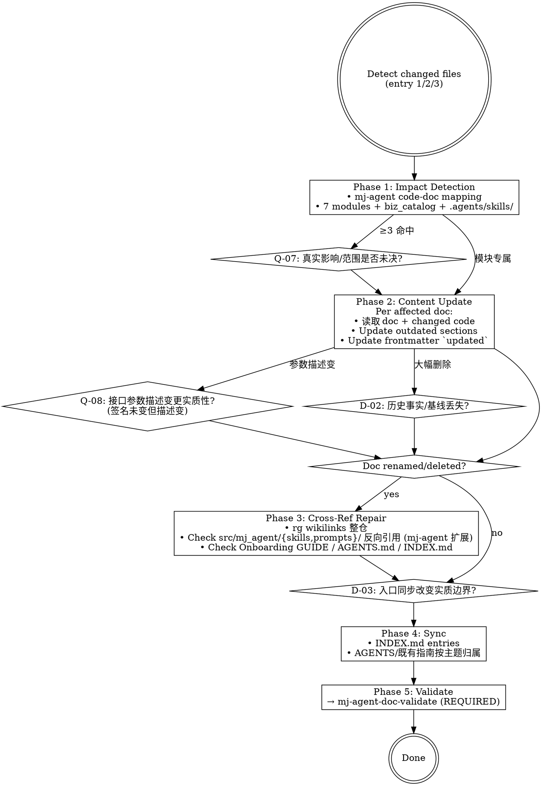

# mj-agent Doc Sync

## 本技能的执行约定

执行前读取 [共用执行边界](../../references/execution-boundaries.md)。先核接受基线、任务授权及实际workspace/ref/SHA；基线内普通实施自主，实质安全/业务/权限/breaking/AC/gate变化先Owner决定。授权未撤销且目标/对象/环境/权限/风险未实质变化时复用，普通内容迭代仍核版本但不逐内容重批。技术拒绝保留原错并返回 `BLOCKED_EXECUTION_ROUTE`，不绕过。独立调用返回本范围结果；完整闭环已获授权时按检查点继续；委派返回协调者。


## 触发与职责详述

This skill detects documentation impact from mj-agent code changes (src/mj_agent/ + biz_catalog + .agents/skills/ + scripts/ + infra/) and executes updates, repairing cross-references and syncing INDEX.md plus AGENTS/既有指南主题归属 allowlist. Make sure to use this skill whenever the user says "同步文档", "文档过期了", "修复引用", "代码改了文档没更新", "update docs for code change", "fix stale references", "sync documentation", "docs are out of date", "Stage 8 sub doc-sync", "tri-track CLAUDE sync" in the mj-agent context, after merging PRs that touch src/mj_agent/, biz_catalog/, scripts/, .github/workflows/, .env.example, .agents/skills/, or .codex/config.toml. Outputs per-affected-doc update plan; required sub-call mj-agent-doc-validate before declaring done. Do not use for: writing brand new doc (use mj-agent-doc-author), pre-commit self-check (use mj-agent-flow-self-review which sub-calls this skill), or full Plan body authoring (use mj-agent-flow-plan).


## Overview

检测 mj-agent code 改动对 docs 的影响，执行更新，修复 cross-references，同步 INDEX.md + AGENTS.md（tri-track 三段分组 + §6.4 **4 类 allowlist**）。**Stage 8 sub** of HITL_Prompt 17-stage 闭环。

> **§6.4 4 类 allowlist**（PR #173 v2.2 显式展开）：类 1 全局高频标准 / 类 2 高频运行信息 / 类 3 项目目录入口 / 类 4 **mj-agent 特化 runtime 语义**（LLM provider matrix + Data boundary L1-L4 + HITL gates）。命中任一类才触发 A6 sync 检查；其余 doc 改动默认不进 AGENTS.md。

## Entry Points

1. **User-provided**: "我改了 X，更新文档" → 用提供的文件清单
2. **Git-based**: `git diff --name-only develop...HEAD` 检测改动文件
3. **Drift scan**: 周期性 audit doc 声明 vs 当前代码状态

## Workflow



## Phase 1: mj-agent Code-Doc Mapping

| Code 路径 | 影响的 docs |
|---|---|
| `src/mj_agent/agent.py` | `docs/design/agent/[SPEC]_*.md` / `repo:README.md` 架构概览与 `repo:src/mj_agent/AGENTS.md` / `README.md` "架构概览" 段（PR #171 起新加；ASCII 拓扑图，需保持简化版与 AGENTS.md 同步）/ `docs/guide/[GUIDE]_Developer_Onboarding.md` §7 |
| `src/mj_agent/llm.py` | `repo:README.md` LLM provider 与 `repo:config/README.md` / `README.md` "LLM provider" 段（PR #171 保留；provider 表 + .env 配置）/ Studio walkthrough / **§6.4 类 4 命中**（runtime 语义）|
| `src/mj_agent/prompts/*.md` | **B 风味**：触发 §3.1实质风险；经 mj-agent-runtime-prompt-version-bump 分析→影响分类→实施/决定 |
| `src/mj_agent/skills/*/SKILL.md` | **B 风味**：触发 §3.1实质风险；经 mj-agent-runtime-skill-doc-improve 分析→影响分类→实施/决定 |
| `src/mj_agent/tools/sql/*.py` | `docs/design/agent/[SPEC]_*.md` / `repo:policies/data-boundary.md` / `README.md` "Data boundary" 段（PR #171 保留）/ ADR-006 / **§6.4 类 4 命中** |
| `src/mj_agent/integrations/mj_system_db.py` | `repo:policies/data-boundary.md` / `README.md` "Data boundary" 段 / ADR-006 / ADR-009 / **§6.4 类 4 命中** |
| `src/mj_agent/biz_catalog/qcm_catalog.yaml` | `docs/design/agent/[SPEC]_biz_catalog_*.md` / `scripts/diff_biz_schema.py` 输出 |
| `src/mj_agent/config.py` | `repo:config/README.md`（应用配置）与 `repo:.env.example`（仅公开变量名） / `.env.example` / `config/README.md` |
| `tests/{unit,eval,integration,smoke,contract}/` | `repo:sdd/workflows/execution-loop.md` §5 pytest 段 |
| `docker/` | `repo:sdd/workflows/execution-loop.md` §5 Docker 段 / `docs/guide/[GUIDE]_Developer_Onboarding.md` §7 / mj-agent-infra-docker-compose SKILL |
| `pyproject.toml` / `uv.lock` | `repo:sdd/workflows/execution-loop.md` §5 / CHANGELOG.md（如显著 dep 变化） |
| `.github/workflows/` | AGENTS.md CI 段 / mj-agent-git-push GUIDE |
| `.env.example` | `repo:config/README.md`（应用配置）与 `repo:.env.example`（仅公开变量名） / `config/README.md` |
| `langgraph.json` | `docs/guide/[GUIDE]_Developer_Onboarding.md` §7 |
| `.agents/skills/<name>/SKILL.md` 改动 | `.agents/skills/SKILL_INDEX.md` / 实际高频工程入口；不机械刷新 infra 冻结摘要 |
| `plans/<topic>/` 或 INTENT 路径/主关联变化 | working/canonical 活动引用、Issue/PR 关联、`task_delivery.py` 实际路由；固定基线分开保留 |
| `.codex/hooks.json` 改动 | AGENTS.md A13 自检（v2.1 §7.7） |
| `.codex/config.toml` 改动 | AGENTS.md A14 自检 + 待落地 `[STANDARD]_MCP_Server_Governance_v1.0` |

> **§7.2.1 反向扫描**（mj-agent 扩展，per HITL_Prompt §4.9 Rule 5a）：除 5 类通用改动（rename / move / SQL-rename / DDD-restructure / internal-opt）外，加 in-source canonical body change（src/mj_agent/{skills,prompts}/）+ biz_catalog drift 反扫。

## Phase 2: Content Update

per affected doc：

1. side-by-side 读 doc + changed code
2. 找出 outdated sections
3. 更新 content 保持文档结构
4. 更新 frontmatter `updated`（实质改动时）；version bump（如适用）

**触发条件**：
- 接口参数描述变但函数签名未变 → **Q-08** 实质性判断
- 大段改写 → **D-02** 核丢失的事实/旧决定及可恢复性；普通内容更新自主，文件删除另核具名授权

**Substantive change rule**: 仅在改动影响语义或行为指引时更新 `updated`。typo / formatting → **不**更新 `updated`。

## Phase 3: Cross-Reference Repair（mj-agent 扩展）

如有 doc renamed / deleted：

1. rg 旧路径/符号与其相对写法：`docs/`、`plans/`、`policies/`、`sdd/`、`.agents/`、入口 markdown、`.github/` 和实际路由消费者；同时检查 Markdown 链接、wikilinks、backtick 路径与路由字段
2. **mj-agent 扩展（per HITL_Prompt §4.9 Rule 5a）**：grep `src/mj_agent/skills/**/SKILL.md` + `src/mj_agent/prompts/*.md` body 中的 backtick 引用（in-source canonical 是反扫目标）
3. **Always check**: `docs/guide/[GUIDE]_Developer_Onboarding.md`（高频 cross-reference 目标）
4. 逐命中分活动引用与固定提交/完整快照/旧决定；活动引用按使用文档位置修复，冻结证据保留可恢复，不无差别全替换。来源忠实与基线接受分别核，纯路径调整不重置业务接受，实质内容变化旧接受只覆盖旧内容。
5. 涉及 working 补号改名时读 [创作与引用说明](../../references/working-docs-and-intent.md)：先核旧/新绝对路径、冲突、Git 状态、引用与路由，改后核完整性和实际 loader。task_id、INTENT ID、历史基线保持；部分成功先对账，旧副本不能成为第二主 Plan。

## Phase 4: Sync

**入口边界核对**：按下述 allowlist 同步真实入口。行数是复核范围的提示，普通授权内同步自主；改变治理/信任/权限等实质边界才交 Owner 决定。

1. **INDEX.md**：手动更新对应 section 的 entry（mj-agent 当前未有 validator-owned managed-block 自动重建；Phase 2+ 落地）
2. **AGENTS.md sync 两轴**：
   - **触发轴**：§6.4 **4 类 allowlist**（Meta v2.2 §6.4，PR #173 显式展开）—— 类 1 全局高频标准 / 类 2 高频运行信息 / 类 3 项目目录入口 / 类 4 **mj-agent 特化 runtime 语义**；命中任一才触发 A6 sync
   - **落位轴**：tri-track 三段分组（Meta v2.2 §6.4.1）—— 按改动 doc 的 `track` 值落入对应段：
     - `track: code` → `## Code-Side Documentation` 段
     - `track: agent` → AGENTS/既有指南的 agent 主题入口（按当前结构定位）
     - `track: engineering-workflow` → AGENTS/既有指南的工程主题入口（按当前结构定位）
     - `track: shared` → 元规则段（顶部）
   - **项目根 markdown 例外**：README/CONTRIBUTING/CHANGELOG/GLOSSARY/AGENTS.md 改动（per Meta v2.2 §2.6）不进入 tri-track 落位轴（无 `track` 字段）；但若触发 §6.4 任一类（如 README "LLM provider" 段触类 4），仍需 A6 sync 检查

Sync 覆盖实际受影响的 canonical、治理入口和 working 活动引用，包括 `plans/**`、`.agents/**`、Issue/PR 关联与交付路由；不把 working 排除在迁移反扫之外。working 不强制局部 INDEX，也不因引用更新批量改写历史正文。Intent/INDEX 不复制实时进度。

## Phase 5: Validate

**REQUIRED SUB-SKILL**：`mj-agent-doc-validate` — 每个修改 doc 都跑。

## 人工交互节点

| 时机 | 触发条件 | 抑制条件 | 问题 ID |
|---|---|---|---|
| Phase 1 后 | 真未决范围/目标取舍 | 能查明的技术影响自主查，原授权覆盖的同步继续 | Q-07 |
| Phase 2 中（接口描述变） | 参数类型/名称描述变但函数签名未变 | 用户说"只改格式/注释" | Q-08 |
| Phase 2 中（大段改写） | 可能丢失历史事实或接受基线 | 先保存可恢复旧基线；只有新的实质取舍/文件删除才需决定 | D-02 |
| Phase 4 前（入口边界） | 同步可能改变治理/信任/权限 | 普通入口同步在原授权内继续，实质变化先 Owner | D-03 |
| Phase 1 后（B 风味命中） | mapping 命中 src/mj_agent/{skills,prompts}/* | 经 mj-agent-runtime-* 分析 + 影响分类 + 实施/决定 | **Q-B1**（mj-agent 专属 §3.1实质风险） |

### Q-B1（mj-agent 专属）

```
检测到 code 改动触及 src/mj_agent/{skills,prompts}/**（B 风味 in-source canonical）。
§3.1实质风险面 runtime-skill-content-change / prompt-version-or-body-change 触发；建议先：
(1) 用 mj-agent-runtime-skill-doc-improve（如 SKILL.md）或 mj-agent-runtime-prompt-version-bump（如 system.md）分析→影响分类→实施/决定
(2) 独立领域/Prompt视角核验（不要求真人或固定人数）
(3) runtime skill在范围授权内落盘 + 再同步 docs

runtime 部分交对应领域技能保持契约与负例证据；其他独立同步继续。技术拒绝保持原错，不通过更换入口跳过边界。
```

## What This Skill DOES NOT DO

- ❌ 不写新文档（用 mj-agent-doc-author）
- ❌ 不替代 mj-agent-flow-self-review（self-review §3 本地验证段嵌套调本 skill；本 skill 不输出 11/12-item checklist）
- ❌ 不直接改 in-source canonical（B 风味必走 propose-via-runtime 流程）
- ❌ 不删 legacy docs（用 mj-agent-doc-migrate 走 archive workflow）
- 入口按 allowlist 与真实主题归属同步，普通更新自主；未决定的治理边界变化保持待答

## Sub-skill / Tool Calls

| Tool | 用途 |
|---|---|
| shell `git diff --name-only` | Phase 1 entry 2 |
| 读取 | Phase 2 doc + code side-by-side |
| 编辑 | Phase 2 / Phase 4 update |
| rg | Phase 3 cross-ref + 反向扫描 |
| 向 Owner 询问 | Q-07/Q-08/D-02/D-03/Q-B1 |
| `mj-agent-runtime-*` | Q-B1 触发；B 风味 分析→影响分类→实施/决定 |
| `mj-agent-doc-validate` | Phase 5 sub-call |

## Reference Files

- `repo:sdd/workflows/execution-loop.md` §1（Stage 8 在 loop 的位置；反向扫描含 in-source canonical）
- `repo:policies/documentation.md` §2.6（项目根 markdown 治理例外）+ §7.1（4 类 allowlist；PR #173 显式展开）+ §7.2（AGENTS/既有指南按主题归属）
- `repo:docs/rule/[STANDARD]_GitHub_Markdown.md` §14（项目根 README 与 Markdown 特例；PR #173 新加）
- `repo:README.md` 架构概览与 `repo:src/mj_agent/AGENTS.md` / "Data boundary" / "Commands" / "LLM provider" 段（high-frequency sync 目标；§6.4 类 1-4 全覆盖）

## Anti-patterns

- **不要** 绕过 runtime skill 直改 src/mj_agent/{skills,prompts}/（B 风味必经 mj-agent-runtime-* 分析→影响分类→实施/决定）
- **不要** 未经实质治理决定改变AGENTS边界（§6.4.1三段分流的普通同步自主；治理边界实质变化先Owner决定）
- **不要** 跳过 §7.2.1 反扫的 mj-agent 扩展（in-source canonical body 是反扫目标）
- D-02/D-03 是实质影响核对，行数本身不新增审批；未答实质决定不能当默认或沉默同意
- **不要** 主动维护项目根 markdown 5 件的 frontmatter（README/CONTRIBUTING/CHANGELOG/GLOSSARY/AGENTS.md）—— per Meta v2.2 §2.6 例外，项目根 markdown 不写 frontmatter；A1-A3 不适用；本 skill 仅在「项目根 markdown 段内容反映了 §6.4 4 类某项」时同步内容，不补 frontmatter

## Handoff

```
Sync 完成 → mj-agent-doc-validate 全跑 → PASS 后 mj-agent-git-commit
B 风味场景 → 先 mj-agent-runtime-* 分析 → 影响分类 → 实施/决定 → 再 sync
```
