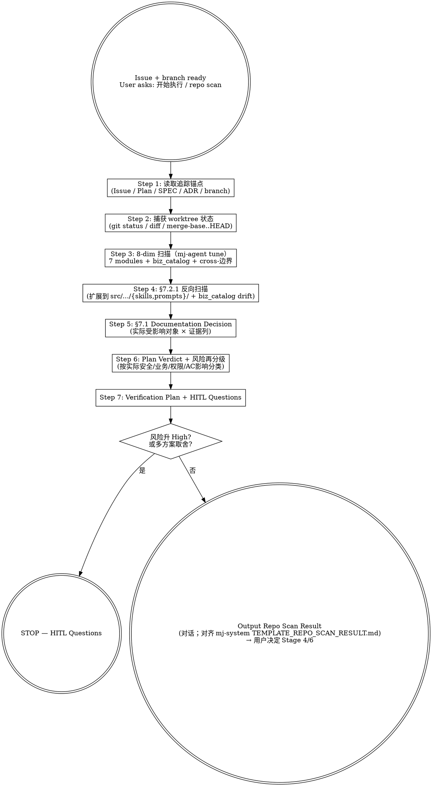

# mj-agent Flow — Repo Scan (HITL Stage 3)

## 本技能的执行约定

执行前读取 [共用执行边界](../../references/execution-boundaries.md)。先核接受基线、任务授权及实际workspace/ref/SHA；基线内普通实施自主，实质安全/业务/权限/breaking/AC/gate变化先Owner决定。授权未撤销且目标/对象/环境/权限/风险未实质变化时复用，普通内容迭代仍核版本但不逐内容重批。技术拒绝保留原错并返回 `BLOCKED_EXECUTION_ROUTE`，不绕过。独立调用返回本范围结果；完整闭环已获授权时按检查点继续；委派返回协调者。


## 触发与职责详述

This skill orchestrates mj-agent Repo Scan — the systematic fact-check of repo state against an Issue / branch / Plan before entering Plan / SPEC / Implementation (HITL Stage 3). Make sure to use this skill whenever the user has an Issue + branch and is about to write Plan / SPEC / code, or says "开始执行", "按 plan 实施", "先扫一下仓库", "repo scan", "仓库事实核查", "事实核查", "verify Plan against repo", "Plan 是否成立", "文档决策", "Documentation Decision", "反向扫描", "既有文档失真", "stale doc scan", "HITL Stage 3", "阶段 3" in the mj-agent context. Runs 8-dim scan adapted for mj-agent (no n8n; adds biz catalog drift + runtime SKILL/PROMPT reverse scan), produces §7.1 Documentation Decision matrix (10 doc types × Create/Update/None) plus Plan Verdict, and surfaces HITL questions when risk re-classifies upward. Outputs structured Repo Scan Result in conversation; does NOT modify any repo-tracked file. Do not use for: Stage 0 Intake admissibility (use mj-agent-flow-intake), Stage 4 Plan body authoring (use mj-agent-flow-plan), Stage 8 Implementation (use mj-agent-flow-implement), Stage 9 scope drift detection (PR-B3+ mj-agent-flow-scope-drift), or doc-only evaluation (use mj-agent-doc-plan in PR-B4).


## Overview

Authoritative orchestrator for HITL Stage 3 — fact-check between Stage 2 (branch created) and Stage 4 (Plan authoring) / Stage 6 (SPEC). Verifies Issue / Plan still holds against current mj-agent repo reality（code, in-source canonical, biz catalog, config, tests, docs），produces Documentation Decision driving subsequent stages.

**Key constraint**: read-only. Scans / reasons / reports — never edits code, prompts, biz_catalog, config, or documents.

**Why this skill exists**:
- §7.2.1 reverse scan (5 改动类型 × grep) and §7.1 10-row decision matrix are easy to miss
- mj-agent 专属：biz_catalog drift detection + runtime SKILL.md/system.md reverse scan（in-source canonical 进入反向扫描目标范围）
- Centralizing here ensures every downstream Plan / SPEC / Implementation has same evidence base

**Reference**:
- `mj-system@docs/rule/[STANDARD]_AI_Engineering_Repo_Scan.md` v1.0（Lite Phase A 占位）
- `repo:sdd/workflows/execution-loop.md` §4.1（Stage 3 → 本 skill 映射；per-stage prompt 未 re-port，历史源 HITL_Prompt §4.4 Repo Scan prompt）

## Workflow



## When to Run This Skill

**MUST run repo scan**：
- 用户基于已有 GitHub Issue 开始工作
- 用户基于已有 branch / worktree 继续任务
- 用户基于已有 Plan 进入 SPEC 或实现（"按 plan 实施" / "可以编码了吗"）
- 涉及代码 / in-source canonical / biz_catalog / 配置 / docs / CI 中高风险任务

**MAY skip full scan**（仍做最小判断）：

| 场景 | 处理方式 |
|---|---|
| 纯文档拼写 / 格式 / 链接修正 | 扫目标文档 + 索引 + 关联规范 |
| 低风险局部代码修正（typo / docstring / < 50 行单文件） | 扫目标模块 + 测试 + 直接关联文档 |
| 用户只问概念 / 解释代码 | 不进入 Repo Scan |
| PR Review 阶段 | 用 mj-agent-git-review-pr 或 mj-agent-flow-self-review（PR-B3+） |

## Step 1: 读取追踪锚点

```bash
# 1. GitHub Issue
# Issue 必须来自已明确的本仓真实关联，不从 branch 任意数字推导
gh issue view <confirmed-issue-number> --repo MJ-AgentLab/mj-agent --json title,body,labels

# 2. 本地 [ISSUE]（canonical 治理产物，Phase D 起首份）
ls docs/issues/[ISSUE]_*.md 2>/dev/null

# 3. Plan / Intake（working 文档）
rg --files plans    # 枚举新嵌套目录与历史根文件，再按正文真实关联定位

# 4. SPEC（按 mj-agent 模块定位）
git diff --name-only HEAD | grep -oE 'src/mj_agent/[a-z_]+/' | sort -u | \
  while read mod; do ls "docs/design/$(basename "$mod")"/[SPEC]_*.md 2>/dev/null; done

# 5. 相关 ADR
rg --files decisions
```

**为什么重要**：锚点让原意/应有行为/实施范围可核。先按实际文档决策判定需要哪些类型；独立报告任务无 Plan 合法，需要而缺失才具体列补齐入口。

## Step 2: 捕获 worktree 状态

```bash
git status --short
git branch --show-current
git diff --name-only HEAD
git diff --stat HEAD
git diff $(git merge-base develop HEAD)..HEAD --name-only
# 用 merge-base 而非 develop..HEAD（避免 develop advance 引入假 diff）
```

如在 mj-agent 仓根（bare repo）下 → STOP，提示 cd 到具体 worktree。

## Step 3: 8-dim 扫描（mj-agent tune）

| § | 维度 | 检查重点 | 工具 |
|---|---|---|---|
| 6.2 | **mj-agent 7 模块** | agent.py / llm.py / prompts/ / skills/ / tools/{sql,biz_context} / memory / integrations / config / server / ui | 文件枚举 `src/mj_agent/**`, 读取 |
| 6.3 | **API 与 Studio** | LangGraph Studio (langgraph.json) / Chainlit `src/mj_agent/ui.py` / CLI `src/mj_agent/server/cli.py` (typer) | 读取 |
| 6.4 | **真实数据流（biz 域）** | qcm_catalog.yaml 镜像 / biz_dws + biz_dwd allowlist / 可见表清单 | 读取 qcm_catalog + SKILL.md；漂移看 diff_biz_schema.py（offline 快照，见下） |
| 6.5 | **数据库** | mj-system biz pg 只读消费者（**不**有 schema 演进权；ADR-006/009 红线）；mj-agent-postgres（memory checkpointer）；mj-agent-redis（reserved） | biz 侧：scan 阶段无 live 载体（见下三层）；memory 侧：mcp pg-mj-agent-memory-*（自有 checkpointer 库，非 biz 边界对象） |
| 6.6 | **配置/环境/部署** | `.env` / `.env.example` / `secrets.enc` / `config/secrets/*.yml` / `compose.yaml` / `langgraph.json` / DEV/TEST/PROD profile | 读取 |
| 6.7 | ~~n8n~~ | **跳过**——mj-agent 不用 n8n（与 mj-system 差异） | — |
| 6.8 | **测试与验证** | 5 类 pytest（unit/eval/integration/smoke/contract）+ ruff + mypy strict + python -m compileall | 文件枚举 `tests/**` |
| 6.9 | **文档治理** | docs/{rule,adr,assessments,_templates,infrastructure,guide,runbook,issues,design,evaluation,contracts}/ + INDEX.md + AGENTS.md + CHANGELOG.md | 文件枚举 `docs/**` + 读取 |

> **§6.4 硬规则**：涉及业务字段时 **必须** 读真实列名（`find_biz_context` 返回 / `describe_biz_table` 真实列）。**不**得仅凭"qcm_xxx 看起来像 numeric"推断。**不**得绕过 4-tool 链用 raw PostgreSQL / postgres MCP / 任何 DB 客户端直读 biz 数据（v5 §5.1 数据边界；对 Codex 与 Codex 同等生效）。

**biz schema 事实怎么拿**（§6.4 / §6.5 biz 侧）——分三层，**scan 阶段没有 live 载体**：

1. **仓内可离线核对**：`src/mj_agent/biz_catalog/qcm_catalog.yaml`（镜像）与
   `src/mj_agent/skills/*/SKILL.md`（可见表清单）直接 读取，不需要任何凭据。scan 的绝大
   多数问题在这一层就能答。
2. **catalog 漂移检测**：`uv run python scripts/diff_biz_schema.py` —— offline，只读
   `.mj-agent-local/biz-schema-snapshots/`（gitignored）下 Owner 背书的 sanitized 快照。
   **按 result code 分支**：`SKIP_NO_SNAPSHOT` / `SKIP_STALE_SNAPSHOT`（均 exit 0）= 什么
   都没验证，如实记「未验证」；`PASS_NO_DRIFT` = 无漂移；`DRIFT_DETECTED`（exit 1）= 有漂移；
   `REJECT_INVALID_SNAPSHOT`（exit 2）= 快照不合法，停下报错。**只判 `$?==0` 会把 SKIP 误读
   成通过**。
3. **确需真实 schema**：走 sanctioned agent 工具链
   （`find_biz_context → list_biz_tables → describe_biz_table → execute_sql`），即通过
   LangGraph Studio / Chainlit 运行 agent、由 agent 自身发起。

> **不得**在 dev shell 里用 `python -c` 直接 import `mj_agent.tools.sql.introspect` 之类的
> wrapper 去连库。该可执行载体已于 Epic #499 PR-0c 移除：它需要 `.env` 凭据、绕开 agent
> 运行时，并且把「目标库是不是 prod」变成人肉判断。`scripts/fetch_biz_schema.py` 同期改为
> fail-closed tombstone（exit 2），没有替代的 live fetch。
>
> **§6.5 硬规则**：mj-agent 是 biz pg 只读消费者；任何 schema 修改需求必须返到 mj-system 上游开 Issue（mj-agent 侧不能 V__/R__ migration）。
>
> **§6.6 硬规则**：生产 secret / .env / secrets.enc / CI/CD 发布链路 → 按实际影响升档 + 实质变化才HITL。

## Step 4: 反向扫描（§7.2.1，hard rule，mj-agent 扩展）

mj-agent **扩展反向扫描目标**：除 mj-system 原 5 类外，新加 in-source canonical 与 biz_catalog 反向扫描。

| 改动类型 | 反向扫描动作 | grep 模板 |
|---|---|---|
| 函数 / 类 / 方法重命名 | grep `docs/**/*.md` + `AGENTS.md` + **`src/mj_agent/skills/**/SKILL.md`** + **`src/mj_agent/prompts/*.md`** 中 backtick 引用 | `rg "\`<old_name>\`" docs/ AGENTS.md src/mj_agent/skills/ src/mj_agent/prompts/` |
| 文件移动 / 路径重组 | grep `docs/**/*.md` + `AGENTS.md` + INDEX.md + **`src/mj_agent/skills/**/SKILL.md`** + **`src/mj_agent/prompts/*.md`** 旧路径 | `rg "\`<old/path/file.py>\`" ...` |
| 列名 / 表名 / SQL 对象重命名（**触发 biz_catalog 漂移**） | grep `docs/**/*.md` + qcm_catalog.yaml + skills/safe-sql-analysis SKILL.md curated examples | `rg "<old_col>" docs/ src/mj_agent/biz_catalog/qcm_catalog.yaml src/mj_agent/skills/` |
| DDD 层重组 / 模块迁移（接口不变） | review SPEC §实现 + GUIDE 代码路径示例 + `repo:README.md` 架构概览与 `repo:src/mj_agent/AGENTS.md` | 读取 SPEC + rg |
| 性能 / 内部行为优化（接口不变） | review SPEC 性能段 + RUNBOOK 诊断步骤 + ASSESSMENT 后置评估计划 | 读取 SPEC + RUNBOOK |
| **biz_catalog mirror 漂移**（mj-agent 专属） | `uv run python scripts/diff_biz_schema.py`（offline；只读 sanitized 快照。SKIP_NO_SNAPSHOT / SKIP_STALE_SNAPSHOT = 未验证，不是通过） | scripts/diff_biz_schema.py |
| **runtime SKILL/system.md body 改动**（mj-agent 专属） | 触发 §3.1语义影响核对；列出受影响 in-source canonical | Direct file diff |

每条命中文档必须列入 Step 5 §7.1 表（Action=`Update`，Existing Target=命中文档，Evidence=grep 命令 + 命中行号）。

未命中也必须显式说明（"已 grep 反扫，无引用" / "不涉及反向扫描 N 类改动"）。

## Step 5: Documentation Decision 矩阵（§7.1）

按 doc-plan 对每个实际受影响对象判 Create/Update/None，列准确目标/已有正本、理由、来源、track/schema、依赖与必须就绪时点。以当前政策与真实 scope 为准，不固定十行；覆盖 INTENT/Issue 原意、Intake、Plan、Report/Assessment 及必要 SPEC/ADR/其他 canonical、导航。默认对话输出事实扫描，不为表格补造文档。

涉及任务目录或原意时读 [创作与引用说明](../../references/working-docs-and-intent.md)：核四式 topic、真实主要关联、无 Plan 的独立目录、共享/子 Plan 归属；检查七/九字段、两套状态与准确接受基线。补号改名只修活动引用，固定提交/旧快照/历史决定保留可恢复；task_id 与 INTENT ID 不由目录重算。

**完成判定**：每个影响和未决项都有事实来源、结论/限制与恢复点，后续作者能据此动笔；不可得证据保持 UNKNOWN，不用推断补成 PASS。

## Step 6: Plan Verdict + 风险再分级

### Plan Verdict（必出一项）

```
- No Plan needed           → 独立 Intake/Report 任务；记录其真实交付条件
- Plan still valid          → Stage 4 修订 / Stage 6 SPEC
- Plan needs update         → 列出需写回 Plan 的 §
- Split issue               → 范围过大；建议拆 Issue/PR
- Need spike                → 真实数据流/依赖未知；先小验证
- Need HITL                 → ≥1 高风险问题未确认；走 Step 7
```

### 风险再分级（mj-agent 专属升档）

如本扫描发现四类runtime有实际安全/业务/外发/接受变化，按真实影响分类；路径本身不升档：
- runtime-skill-content-change（src/mj_agent/skills/**/SKILL.md body）
- prompt-version-or-body-change（system.md `version`）
- biz-catalog-sync（qcm_catalog.yaml）
- sql-guardrail-relax（tools/sql/{guardrail,precheck}.py）

```
"Risk escalated: <旧> → High，原因：触及 mj-agent 专属 §3.1 第 N 项 (<触发源>)"
```

## Step 7: Verification Plan + HITL Questions

### Verification Plan

```
- Level A 只读检查:
    uv run ruff check
    uv run mypy src/mj_agent
    uv run --frozen --no-sync python scripts/sdd/run_offline_pytest.py tests/unit
    uv run --frozen --no-sync python scripts/sdd/run_offline_pytest.py tests/eval
    python -m compileall src
    python scripts/check_wikilinks.py     # 文档变更时
    python scripts/check_frontmatter.py   # 文档变更时
    python scripts/check_working_docs.py  # working目录/深相对链接
- Offline external bands（只证明 structured policy skip；凭据不启用）:
    uv run --frozen --no-sync python scripts/sdd/run_offline_pytest.py tests/integration
    uv run --frozen --no-sync python scripts/sdd/run_offline_pytest.py tests/smoke -m smoke
- Level B 具名授权（explicit live probe）:
    uv run mj-agent check
    uv run langgraph dev                  # Studio 探针 H1/H2/H3/R1/R2
    docker compose -f docker/compose.yaml up -d
- Checks not run and why:
    <显式说明>
```

### HITL Questions（§3.3 7-段格式）

仅 Risk = Medium/High 或多方案取舍时输出，最多 3-5 个：

```
问题 N：
- 当前观察：
- 不确定点：
- 为什么重要：
- 可选方案：A. / B. / C.
- 我的建议：
- 默认假设：
- 是否必须等待人工确认：<实质决定是；已有授权范围内否> / 否
```

## Output Format

完整对齐 mj-system `TEMPLATE_REPO_SCAN_RESULT.md`（**对话输出**，不写文件）：

```markdown
## Repo Scan Result
- Decision: <Plan still valid / needs update / Split / Need spike / Need HITL>
- Risk Level: <Low / Medium / High>（如升档：Risk escalated: <旧> → <新>）
- Next Step: <Update Plan / Draft SPEC / Implement / Ask HITL / Create follow-up Issue>

## Current State
- <3-5 句仓库事实摘要>

## Evidence Map
| Area | Evidence | Notes |
| Issue / Plan |  |  |
| Code (mj-agent 7 modules) |  |  |
| API / Studio / Chainlit |  |  |
| Data Source (biz_catalog) |  |  |
| Database — biz pg consumer（4-tool 链） |  |  |
| Database — mj-agent-postgres memory（mcp pg-mj-agent-memory-*） |  |  |
| Config / Secrets |  |  |
| Tests / CI |  |  |
| Docs |  |  |

## Affected Areas
- Modules / Code Paths / Studio / Database / Config / CI-Docker / Docs

## Documentation Decision
<Step 5 按实际对象的 Create/Update/None 与证据表>

## Stale Doc Reverse Scan（§7.2.1，mj-agent 扩展）
- 已扫改动类型：<rename / move / SQL-rename / DDD-restructure / internal-opt / biz_catalog-drift / runtime-canonical-change / N/A>
- 命中文档：<列入 Documentation Decision Update 行 / 无命中 / 不涉及>
- grep 证据：`<命令>`
- biz_catalog drift status：`<PASS_NO_DRIFT / DRIFT_DETECTED / SKIP_NO_SNAPSHOT（未验证）/ SKIP_STALE_SNAPSHOT（未验证）/ REJECT_INVALID_SNAPSHOT / 不涉及>`
  <!-- SKIP 必须原样记为「未验证」，不得折叠成 N/A 或 no-drift -->


## Plan Verdict
- 是否成立：…
- 需写回 Plan 的内容：…

## Verification Plan
<Step 7 列表>

## HITL Questions
<Step 7 §3.3 格式，0-5 个>

## Next Step Context
- <交给 Stage 4 / 6 / 8 的执行上下文>
```

## What This Skill DOES NOT DO

- ❌ 不修改 repo-tracked 文件（read-only；不动 src / docs / config / biz_catalog）
- 默认对话输出；明确需要持久化时交 doc-author 保存到所属任务目录的真实 working 类型，或吸收到已有 Plan/规范。扫描本身保持只读，不因此强造 Plan。
- ❌ 不替代 mj-agent-flow-intake（Stage 0 vs Stage 3；intake 在 Issue 创建前，repo-scan 在 branch 创建后）
- ❌ 不替代 mj-agent-doc-plan（doc-plan 是 §7.1 子集；本 skill 上位包含全量事实核查）
- ❌ 不进入 Stage 4 Plan / Stage 6 SPEC（Repo Scan Result 输出后由用户决定下游）
- ❌ 不自动 amend Plan / 拆 Issue / 创建 follow-up（仅在 Plan Verdict **建议**）
- ❌ 不替代 mj-agent-flow-scope-drift（Stage 9 实施中检测；本 skill 是 Stage 3 实施前事实核查）

## Sub-skill / Tool Calls

`mj-agent-flow-repo-scan` 编排 read-only 工具，扫描完成后**不主动**调下一阶段 skill：

| Tool / Skill | 用途 |
|---|---|
| shell `git status` / `diff` / `branch` | Step 2 worktree |
| shell `gh issue view` | Step 1 Issue |
| 文件枚举 / rg | Step 3 8-dim + Step 4 反向 grep |
| 读取 | Step 1 anchors / Step 3 真实数据流 / Step 4 SPEC review |
| `uv run python scripts/diff_biz_schema.py` | Step 4 biz_catalog drift（offline 快照；SKIP ≠ PASS） |
| mcp pg-mj-agent-memory-* | Step 3 §6.5 memory checkpointer 侧（自有库，非 biz 边界对象） |

用户确认 Repo Scan Result 后**由用户决定**调用：

| 后续 skill | 触发条件 |
|---|---|
| `mj-agent-doc-plan`（PR-B4） | Documentation Decision 表有新文档需求 |
| `mj-agent-doc-author`（PR-B4） | 直接进 Stage 6 SPEC/ADR/RUNBOOK |
| `mj-agent-git-issue` | 拆 Issue 或建 follow-up |
| `mj-agent-flow-intake` | Risk 升 High 且范围本质变化 → 重新 Intake |
| `mj-agent-flow-plan` | 进 Stage 4 Plan body 编写 |

## Reference Files

- `mj-system@docs/rule/[STANDARD]_AI_Engineering_Repo_Scan.md` v1.0（Lite Phase A 占位）
- `repo:sdd/workflows/execution-loop.md` §4.1（Stage 3 映射；历史源 HITL_Prompt §4.4）
- `repo:policies/documentation.md` §6（Documentation Decision frontmatter / state 规则）
- `repo:decisions/ADR-006_Fail_Safe_Reads.md` / `repo:decisions/ADR-009_Biz_Domain_As_Primary_Data_Source.md`（数据边界）

## Anti-patterns

- **不要** 在 Repo Scan 阶段修改任何 repo-tracked 文件
- **不要** 创建独立 Repo Scan Result.md（违反 §5 规则）
- **不要** 跳过 §7.2.1 反向扫描（mj-agent 扩展含 in-source canonical + biz_catalog）
- **不要** 忽略真实安全/业务/权限/AC影响，仅按runtime路径升档
- **不要** 用 `develop..HEAD` 算 diff（用 merge-base..HEAD 避免 develop advance 假 diff）

## Handoff to Stage 4 / 6

Repo Scan 完成后输出指引：

```
Repo Scan Result 已输出（对话）。
实质决定停点：存在未决定的目标/业务/安全/权限/AC取舍或缺动作授权；Risk = High 标签本身不触发固定等待
下一步：协调者在任务授权内按依赖推进；实质决定先给 Owner 具体选项和推荐理由
  → Stage 4 mj-agent-flow-plan（写 Plan body）
  → Stage 6 mj-agent-doc-author（直接写 SPEC/ADR/RUNBOOK）
  → 拆 Issue → mj-agent-git-issue
```
