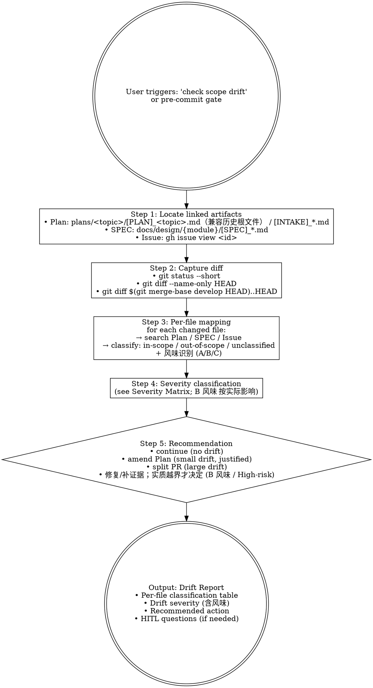

# mj-agent Flow — Scope Drift Gate (HITL Stage 9)

## 本技能的执行约定

执行前读取 [共用执行边界](../../references/execution-boundaries.md)。先核接受基线、任务授权及实际workspace/ref/SHA；基线内普通实施自主，实质安全/业务/权限/breaking/AC/gate变化先Owner决定。授权未撤销且目标/对象/环境/权限/风险未实质变化时复用，普通内容迭代仍核版本但不逐内容重批。技术拒绝保留原错并返回 `BLOCKED_EXECUTION_ROUTE`，不绕过。独立调用返回本范围结果；完整闭环已获授权时按检查点继续；委派返回协调者。


## 触发与职责详述

This skill detects "scope drift" during mj-agent task implementation (HITL Stage 9) — compares the current working tree diff against the linked Plan / SPEC / Issue scope and reports per-file alignment ("in Plan §X" vs "not in Plan"). Make sure to use this skill whenever the user says "范围漂移", "scope drift", "实施超出 Plan", "diff vs SPEC", "drift check", "实施跑偏了吗", "改动还在范围内吗", "Stage 9", "scope check", "scope verification" in the mj-agent context, or before commit/push when significant code has been written. Outputs a drift report with recommendations (continue / amend Plan / split PR / pause for HITL); baseline-preserving record updates are autonomous; material scope/acceptance changes require Owner decision (e.g., amends the Plan via 编辑 per ADR-034); git-level actions (split PR) remain their own gates. mj-agent-specific: classifies B-flavor (in-source canonical) drift by actual semantic impact since they require impact classification under §3.1. Do not use for: pre-commit dual-section + 11-item checklist (use mj-agent-flow-self-review which sub-calls this skill), Stage 10 command matrix (use mj-agent-flow-verify), or Stage 8 coding methodology (use mj-agent-flow-implement).


## Overview

17-stage 闭环中**最易遗漏**的 stage（实施跑偏检测）。比对 working tree diff vs linked Plan / SPEC / Issue scope，识别 commit 前的 implementation drift。

**Reference**: `repo:sdd/workflows/execution-loop.md` §3.1实质风险规则（`实现中 scope 明显扩大`）+ §4.1 的 Stage 3 映射（Repo Scan 反向扫描原理，drift detection 的对偶；历史源 HITL_Prompt §4.4）.

## Workflow



## When to Run This Skill

**MUST run scope-drift check before**：
- Commit 一批工作 scope 不清楚时（用户："我改了好多文件，对吗"）
- Push to PR（pre-push gate；mj-agent-flow-self-review Step 2 嵌套调用）
- 从编码切到文档阶段（确认实现范围已收敛）

**MAY skip**：
- Single-file trivial change（rename / typo / 小 docstring）
- 用户明确"I know it's out of scope, ship it anyway"（仍输出报告，但不阻塞）
- 无任何已确定范围锚点时先做最小 intake/repo-scan；存在独立报告的有效交付条件即可核scope，不强制补Plan

## Step 1: Locate Linked Artifacts

```bash
# 1. Plan / Intake（plans/ 下）
rg --files plans    # 新布局与历史根文件，按任务明确路径/正文关联定位

# 2. SPEC（docs/design/{module}/）
git diff --name-only HEAD | grep -oE 'src/mj_agent/[a-z_]+/' | sort -u | \
  while read mod; do
    spec_dir="docs/design/$(basename "$mod")"
    ls "$spec_dir/[SPEC]_*.md" 2>/dev/null
  done

# 3. Issue（从任务明确来源核真实关联）
# Issue 取明确的本仓任务关联，不按分支数字猜
gh issue view <confirmed-issue-number> --repo MJ-AgentLab/mj-agent --json title,body
```

读取 [创作与引用说明](../../references/working-docs-and-intent.md)，逐项核实际原意正本、应有行为和本任务承担范围。按 Documentation Decision 判断需要哪些工件；独立 Intake/Report 可无 Plan，不以任一类型缺失自动判漂移。本来需要的工件缺失才列具体缺口/影响/恢复点。

把目标原意变化、SPEC行为变化、普通实施安排和目录/链接调整分开判断。目录补号不改 task_id、历史基线或 INTENT ID；活动引用更新，固定提交/快照/旧决定保持。实质内容变化不能以旧接受覆盖；纯路径调整不自动重置业务接受。

## Step 2: Capture Diff

```bash
git status --short                                              # 概览
git diff --name-only HEAD                                       # 改动清单
git diff --stat HEAD                                            # 改动量
git diff $(git merge-base develop HEAD)..HEAD --name-only       # 与 base 比对（merge-base 风格）
```

> 用 merge-base 而非 `develop..HEAD`：避免 develop 自分支创建后 advance 引入"假 diff"。

## Step 3: Per-File Mapping + 风味识别

对每个改动文件，在 Plan / SPEC / Issue 文本中搜索：

| 搜索关键词 | 含义 |
|---|---|
| 文件路径片段（如 `mj_agent/agent.py`） | 显式提及 → in-scope |
| 文件所在 mj-agent 模块（agent / llm / prompt / skill / sql / db / config / biz_catalog） | 模块级提及 → in-scope |
| 文件类别（`src/`, `tests/`, `docs/`, `docker/`, `.codex/`） | 类别级提及 → in-scope（覆盖性） |
| 完全无匹配 | unclassified → 候选 drift |

**风味识别（mj-agent 专属，per ADR-015 §决策点 3）**：

| 路径 | 风味 |
|---|---|
| `src/mj_agent/{config,server,memory,integrations,tools,...}/` + `tests/` | A 纯代码 |
| `src/mj_agent/skills/**/SKILL.md` 或 `src/mj_agent/prompts/*.md` | **B in-source canonical**（按§3.1实际语义影响分类） |
| `docker/` + `pyproject.toml` + `langgraph.json` + `qcm_catalog.yaml` + `.env.example` + `scripts/` | C infra |
| `docker/Dockerfile` 外部 registry 镜像引用（内部 `COPY --from=<stage>` **不**在内） | C infra，但**该子面必停**（`secrets-grants-or-prod-config`；`policies/docker-runtime.md` §4）——漂移进此面须回 Gate 而非归入常规 C |

**输出表格**：

| 改动文件 | 改动类型 | 在 Plan §X | 在 SPEC §Y | 在 Issue scope | 风味 | 归类 |
|---|---|---|---|---|---|---|
| src/mj_agent/agent.py | M | §3.1 ✅ | §FR1 ✅ | ✅ | A | in-scope |
| src/mj_agent/skills/biz-domain-context/SKILL.md | M | — | — | — | **B** | **unclassified + 按实际影响** |
| docs/design/agent/[SPEC]_xxx.md | A | §4 ✅ | (self) | — | — | in-scope |

## Step 4: Severity Matrix（mj-agent 扩展）

| 场景 | Severity | 行动 |
|---|---|---|
| 0 unclassified | **None** | continue |
| 1-2 unclassified，单一模块，小改 (<50 行) | **Low** | continue + commit message 注明 |
| 3+ unclassified 但同一类别（如全 docs/） | **Low-Medium** | continue + PR description "扩展 scope" 说明 |
| 1+ 跨模块 unclassified | **Medium** | amend Plan + 重新对齐 |
| **B 风味影响待核**（in-source canonical 改动未在 Plan） | **按实际影响** | **核实影响；基线内自主，实质越界才决定**；建议先 `mj-agent-runtime-skill-doc-improve` 或 `mj-agent-runtime-prompt-version-bump`（PR-C2）propose diff |
| API/SQL/catalog/public interface的真实安全/业务/breaking/AC越界 | **High** | **核实影响；基线内自主，实质越界才决定** + 询问拆 PR vs 合并 |
| > 50% 文件 unclassified | **High** | 重新做 `mj-agent-flow-intake`（scope 显然漂了） |

## Step 5: Recommendation

按 Severity 输出建议：

```markdown
## Drift Report

### Linked Artifacts
- Plan: `plans/<topic>/[PLAN]_<topic>.md`
- SPEC: `docs/design/{module}/[SPEC]_xxx.md`
- Issue: #<id>

### Diff Summary
- Files changed: 12
- Lines: +400 / -50
- Branch: feature/<id>-<desc>

### Per-File Classification
{table from Step 3，含风味列}

### Severity: Medium
### Recommendation: amend Plan
### Rationale
- 3 个 unclassified 文件涉及 mj-agent 内 sql 模块（Plan §3.2 提及 "可能新增 guardrail" 但未具体）
- 建议在 Plan §3.2 加 "新增 SQL guardrail 规则" 行，然后继续

### HITL Questions
（仅 Severity ≥ Medium 时输出；仅存在真实实质取舍时输出）
1. **改动 src/mj_agent/skills/biz-domain-context/SKILL.md 是否在原 scope 内？**
   - 当前观察：Plan 未提 SKILL body 改动
   - 风味识别：B in-source canonical（按§3.1实际语义影响分类）
   - 选项：A. 接受 → 改 Plan + 走 mj-agent-runtime-skill-doc-improve propose diff（PR-C2）/ B. 不接受 → revert + 拆独立 PR / C. 改 Plan 重对齐
   - 推荐：B（B 风味改动应单独 PR + 独立领域视角核验）
   - 待决定：保留未答，不以推荐、沉默或超时作为决定
   - 实际边界变化需决定：是

### Next Action
- ☐ amend Plan（手动 / 用 mj-agent-doc-author，PR-B4 落地）
- ☐ revert + 单独 PR（B 风味场景）
- ☐ 在 commit message 注明「scope expand: ...」
- ☐ 继续 commit
```

## What This Skill DOES NOT DO

- ❌ 不自动改 Plan（仅建议；用户决定后调用 mj-agent-doc-author，PR-B4）
- ❌ 不拆 PR（仅建议；用户用 mj-agent-git-branch 创建新 branch）
- ❌ 不阻塞 commit（仅 High Severity 时建议 HITL；user 可 override）
- ❌ 不替代 PR review（PR review = Stage 15-16）
- ❌ 不调 mj-agent-flow-self-review（self-review = Stage 11；本 skill = Stage 9，被 self-review Step 2 嵌套调用）

## Sub-skill / Tool Calls

| Tool | 用途 |
|---|---|
| shell `git status` / `git diff` / `git merge-base` | Step 2 capture diff |
| shell `gh issue view` | Step 1 locate Issue |
| 读取 | 读 Plan / SPEC / Issue body |
| rg | 在 Plan / SPEC / Issue 文本搜文件路径片段 |

## Reference Files

- `repo:sdd/workflows/execution-loop.md` §3.1（必停规则之"实现中 scope 明显扩大"）+ §4.1 的 Stage 3 映射（Repo Scan 反向扫描，drift 的对偶；历史源 HITL_Prompt §4.4）
- `repo:sdd/workflows/execution-loop.md`（有效三风味/停点规则；旧 ADR-015 路径基线缺失，仅作历史来源） §决策点 3（3 风味分类，本 skill Step 3 风味识别依据）
- `.agents/skills/mj-agent-flow-self-review/SKILL.md`（Stage 11 上游消费者，Step 2 嵌套调本 skill）

## Anti-patterns

- **不要** 跳过 B 风味识别（核真实安全/业务/权限/AC影响，路径不自动High）
- **不要** 用 `develop..HEAD` 算 diff（用 merge-base..HEAD 避免 develop advance 假 diff）
- **不要** 在 unclassified > 50% 时给 Low（按实际影响升档，重新 intake）
- **不要** 把 SPEC 缺漏当成 drift 推（SPEC 缺漏归 SPEC Delta，由 self-review（execution-loop §6 检查项 5d）处理）

## Handoff

```
Drift Report 已输出。
Severity = None/Low → mj-agent-flow-self-review 继续（Step 4）
Severity = Medium → 用户决定 amend Plan 或 revert，然后回 self-review
Severity = High → 核实影响；基线内自主，实质越界才决定；B 风味建议先 mj-agent-runtime-* propose diff（PR-C2）
```
